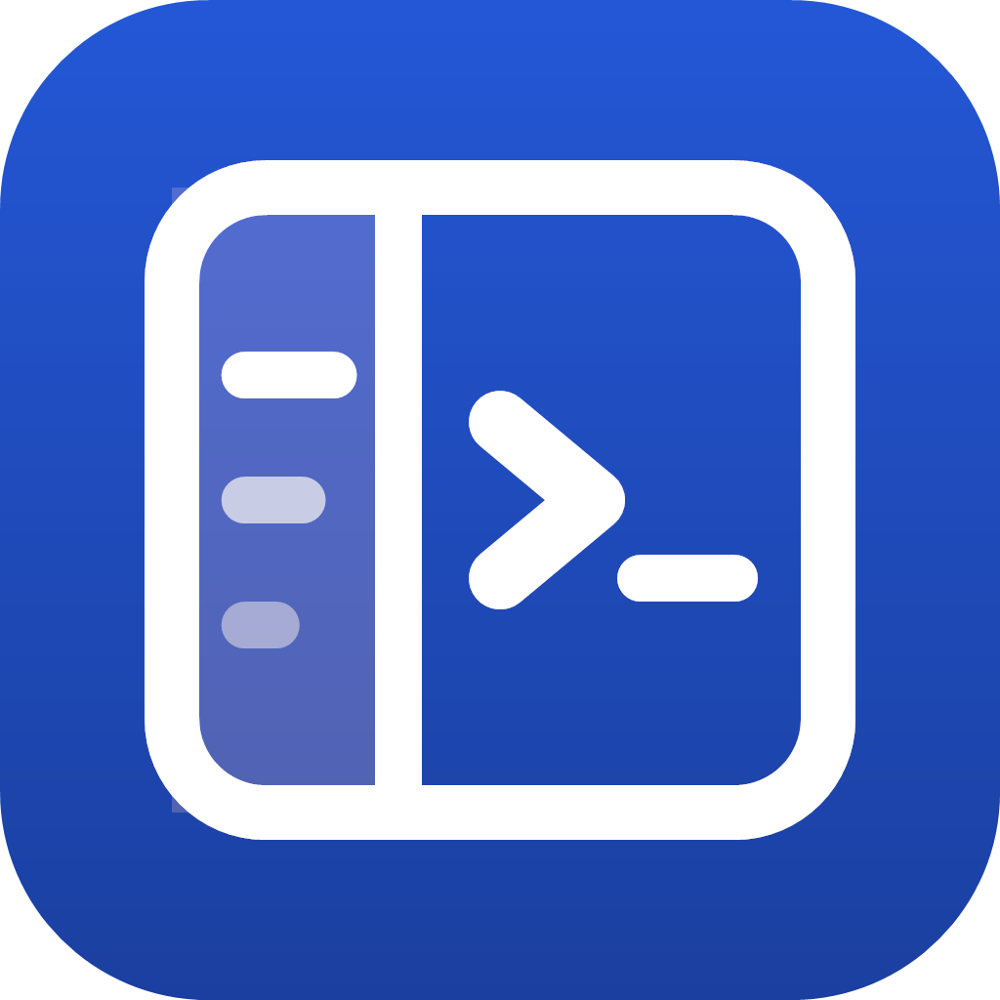
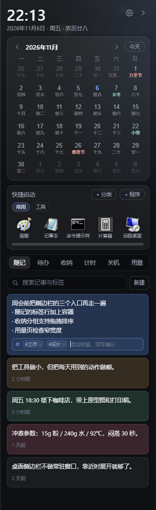
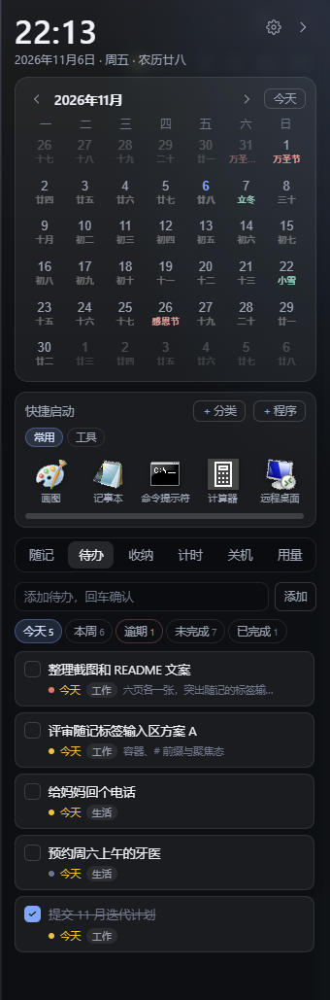
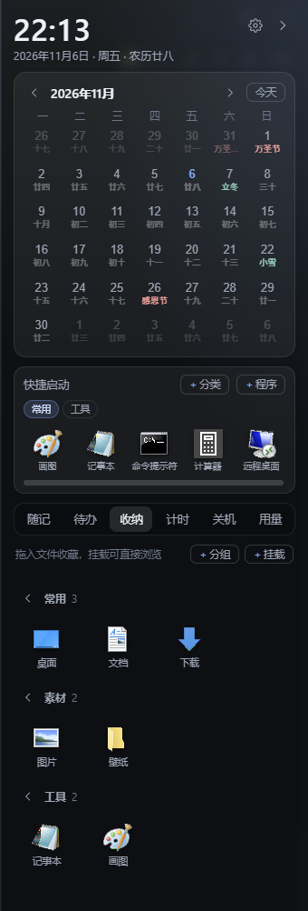
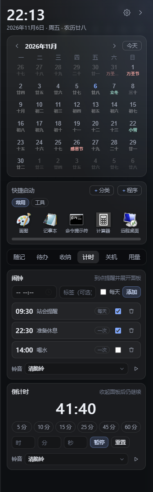
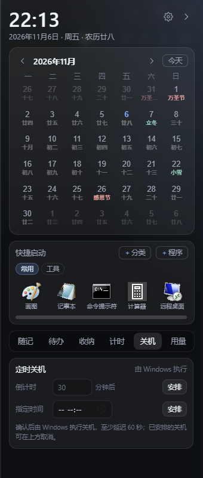
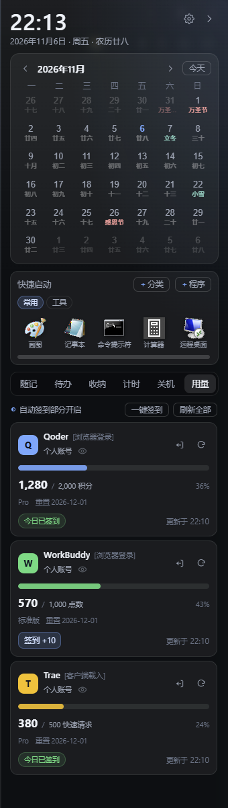

<h1 align="center">
   智爱小助手 · ZhiAi Assistant
</h1>

<p align="center">贴在屏幕边缘的 <b>Windows</b> 桌面侧边栏，日历、待办、随记、收纳、快捷启动、计时与用量都在一屏之内</p>

<p align="center">简体中文 · <a href="README.md">English</a></p>

<p align="center">
  
  
  
  
  
</p>

## 界面一览

<p align="center"><sub>实际运行截图，演示数据；点击图片可查看原图。</sub></p>

<table align="center">
  <tr>
    <td align="center" width="33%">
      <a href="docs/screenshots/notes.png"></a><br>
      <sub>随记 · #标签、搜索与颜色标记</sub>
    </td>
    <td align="center" width="33%">
      <a href="docs/screenshots/todos.png"></a><br>
      <sub>待办 · 今天 / 本周 / 逾期筛选</sub>
    </td>
    <td align="center" width="33%">
      <a href="docs/screenshots/shelf.png"></a><br>
      <sub>收纳 · 分组收藏与挂载</sub>
    </td>
  </tr>
  <tr>
    <td align="center" width="33%">
      <a href="docs/screenshots/timers.png"></a><br>
      <sub>计时 · 闹钟与倒计时</sub>
    </td>
    <td align="center" width="33%">
      <a href="docs/screenshots/shutdown.png"></a><br>
      <sub>关机 · 分钟倒数或指定时间</sub>
    </td>
    <td align="center" width="33%">
      <a href="docs/screenshots/usage.png"></a><br>
      <sub>用量 · 三平台额度与签到</sub>
    </td>
  </tr>
</table>

## 功能简介

> **时间与日程**

### 1. 日历

常驻面板顶部的月历网格，可左右翻月。日期格显示农历、节气与节日，标注法定节假日与调休，放假数据可联网更新。

- **按需显示**：可隐藏整块日历，或只保留公历、关闭副标签。
- **直接落到待办**：点选日期即可查看或新增当天的待办，不必来回切换。

### 2. 待办

按今天、本周、逾期、未完成、已完成五档筛选并显示计数，逾期项高亮提醒，周计划一眼看清。

- **快速录入**：回车即添加，编辑中 `Enter` 保存、`Esc` 取消。
- **删错了也能收回**：删除后 4 秒内可撤销。

### 3. 计时

闹钟、倒计时放在同一个标签页，覆盖提醒与专注两类场景。

- **闹钟**：支持每天重复，单次触发后自动停用；内置 10 款铃音，可静音、试听或自选 WAV。
- **倒计时**：按时/分/秒设置，提供 5/10/15/25/45/60 分钟单行预设，最长 24 小时。

### 4. 关机

按分钟倒数或指定时间安排关机，提交前需要二次确认。

- 最短 60 秒、最长 7 天，到点前可随时取消。
- 计划保存在本机，关闭侧边栏不会取消；执行「完全重置」时会一并取消已安排的关机。

> **记录与收纳**

### 5. 随记

点「新建」立即落库并进入编辑，停手自动保存，不打断思路。

- `#标签` 归类、全文搜索、置顶与 9 种颜色标记。
- `Enter` 结束编辑，`Ctrl+Enter` 另起一段，`Shift+Enter` 只换行。

### 6. 收纳

把文件、文件夹或快捷方式拖进面板即可收藏，把常用资料集中到伸手可及的位置。

- 自定义分组，支持跨组拖拽排序。
- 可挂载常用文件夹，在同一页内逐级浏览，不必打开资源管理器。

### 7. 快捷启动

日历下方的应用 Dock，落在快捷启动区的程序快捷方式会直接成为启动项。

- 支持分类、固定 N×N 网格，可调列数、行数、图标大小与名称显隐。
- 可整块隐藏，或改为横向滚动以容纳更多应用。

> **账号用量**

### 8. 用量

汇总 Qoder、WorkBuddy、Trae 的额度、重置日期与更新时间，不必逐个打开客户端确认。

- **一键签到**：自动签到每天执行一次，失败最多重试 3 次。
- **登录方式**：Qoder / Trae 复用本机客户端已保存的登录态；WorkBuddy 在卡片内用浏览器完成授权。
- 首次进入用量页会显示使用前确认，凭据由 Windows 用户级加密（DPAPI）保存。

## 安装与构建

### 直接使用

从 [Releases](https://github.com/ZhiHui6/ZhiAi-Assistant/releases) 下载 `ZhiAi-Assistant.exe`，放到任意可写目录双击运行，无需安装，首次运行会自动创建数据目录。

- 系统要求：Windows 10 / 11 x64 与 WebView2 Runtime（Windows 11 与较新的 Windows 10 通常已自带）。
- 便携模式：「设置 → 数据 → 存储位置」可改为随程序存放，或用备份导出/导入迁移数据。
- 程序未做代码签名，SmartScreen 提示「未知发布者」时选择「更多信息 → 仍要运行」。

### 从源码构建

依赖 Windows 10 / 11 x64、[Go](https://go.dev/dl/) 1.27+、[Wails CLI v2](https://wails.io/docs/gettingstarted/installation) 与 WebView2 Runtime；Node.js 可选，仅用于生成多语言词条和前端语法检查。

```powershell
go install github.com/wailsapp/wails/v2/cmd/wails@latest

git clone https://github.com/ZhiHui6/ZhiAi-Assistant.git
cd ZhiAi-Assistant

wails dev                            # 热重载开发，devserver http://localhost:34115
wails build                          # 正式构建，产物 build\bin\ZhiAi-Assistant.exe
wails build -debug -windowsconsole   # 调试构建，日志输出到当前窗口
wails build -clean                   # 先清理 build\bin 再构建
```

- **版本**：应用内版本取 `internal/buildinfo/buildinfo.go` 的 `Version`（默认 1.0.0），发布前应与 `wails.json` 的 `info.productVersion` 一致，可用 `wails build -ldflags "-X zhi-ai-assistant/internal/buildinfo.Version=<版本>"` 覆盖；发布 tag 需与版本号相同（如 `v1.0.0`），否则「检查更新」会误报。
- **发布**：推送 `v*` tag（如 `v1.0.0`）会触发 `.github/workflows/release.yml`，在 Windows 上自动构建并上传 `ZhiAi-Assistant.exe` 与同名 `.sha256` 校验文件。
- **更新**：发布资产需包含 `ZhiAi-Assistant.exe` 与 `ZhiAi-Assistant.exe.sha256`（或带 `digest`），否则只能跳转发布页手动下载。
- **多语言**：源词条在 `tools/i18n/`，`frontend/js/locales.js` 为生成物，改动后运行 `node tools/i18n/build-locales.js`。
- **检查**：`npx eslint --config eslint.config.check.mjs frontend/js` 检查前端语法与未定义引用（先 `npm i -D eslint globals`）；项目暂不含自动化测试。

## 使用要点

- **贴边**：面板停靠屏幕左缘或右缘，鼠标靠近展开、离开约 0.2 秒收起，收起后保留书签条；图钉可临时钉住，关闭自动隐藏则常驻，`Esc` 手动收起。
- **托盘与热键**：托盘左键唤出面板，右键可显示/收起、钉住、自动隐藏、开机自启、设置与退出；全局热键默认 `Ctrl+Alt+Space`，被占用时自动尝试备用组合并在托盘提示。
- **多显示器**：可在设置中选择停靠显示器与左/右贴边。
- **外观与语言**：可调玻璃浓度、界面底色、12 小时制、减少动画与面板/书签宽度；支持简体中文、English、繁體中文，默认跟随系统。
- **注意**：定时关机会真正关闭电脑（最长 7 天）；「完全重置」会删除当前存储位置的全部数据且不可撤销，重要数据请先导出备份。

## 数据与隐私

数据默认存于 `%APPDATA%\ZhiAi-Assistant`，可在「设置 → 数据 → 存储位置」改为随程序存放或自定义路径；写入为 JSON 原子写入并保留 `.bak` 备份，支持按类别导出/导入，切换目录会复制数据并自动重启。

程序仅在更新法定节假日（`timor.tech`）、读取额度与执行签到、检查 GitHub 更新时联网，不向自建服务器上传任何内容。额度与签到复用本机客户端登录态或浏览器授权，凭据经 Windows DPAPI 加密，换机或换用户后需重新登录。

> [!WARNING]
> 额度读取与签到使用平台未公开接口，属非官方方式，可能失效或与平台条款冲突；风险由你自己承担，若条款不允许请关闭相关功能。

## 目录结构

```
main.go                  程序入口与 Wails 装配（侧边栏 / 设置窗口）
internal/buildinfo/      应用名、版本号与仓库地址
internal/core/           领域模块：日历/节假日、随记、待办、收纳、挂载、快捷启动、计时、用量
internal/i18n/           界面语言
internal/platform/       Win32 窗口壳、托盘、热键、通知、对话框、开机自启
internal/service/        暴露给前端的绑定层、设置、备份与更新逻辑
internal/winstate/       贴边窗口状态机（展开 / 收起 / 钉住）
frontend/                侧边栏与设置窗口（原生 HTML/CSS/JS，无框架）
tools/i18n/              多语言词条清单与 locales.js 生成脚本
```

## 技术栈

- [Go](https://go.dev/)：程序主体、领域逻辑与服务层
- [Wails v2](https://wails.io/) 与 WebView2：桌面运行时与窗口集成
- Win32 API：贴边窗口、托盘、热键、通知与开机自启
- 原生 HTML / CSS / JavaScript：侧边栏与设置界面，无前端框架

## 许可证

智爱小助手基于 [GNU General Public License v3.0](LICENSE) 开源。Copyright (C) 2026 ZhiHui6.

本程序是自由软件：你可以在自由软件基金会发布的 GNU 通用公共许可证第 3 版条款下重新分发和/或修改它。分发本程序的目的是希望它有用，但不提供任何担保。
