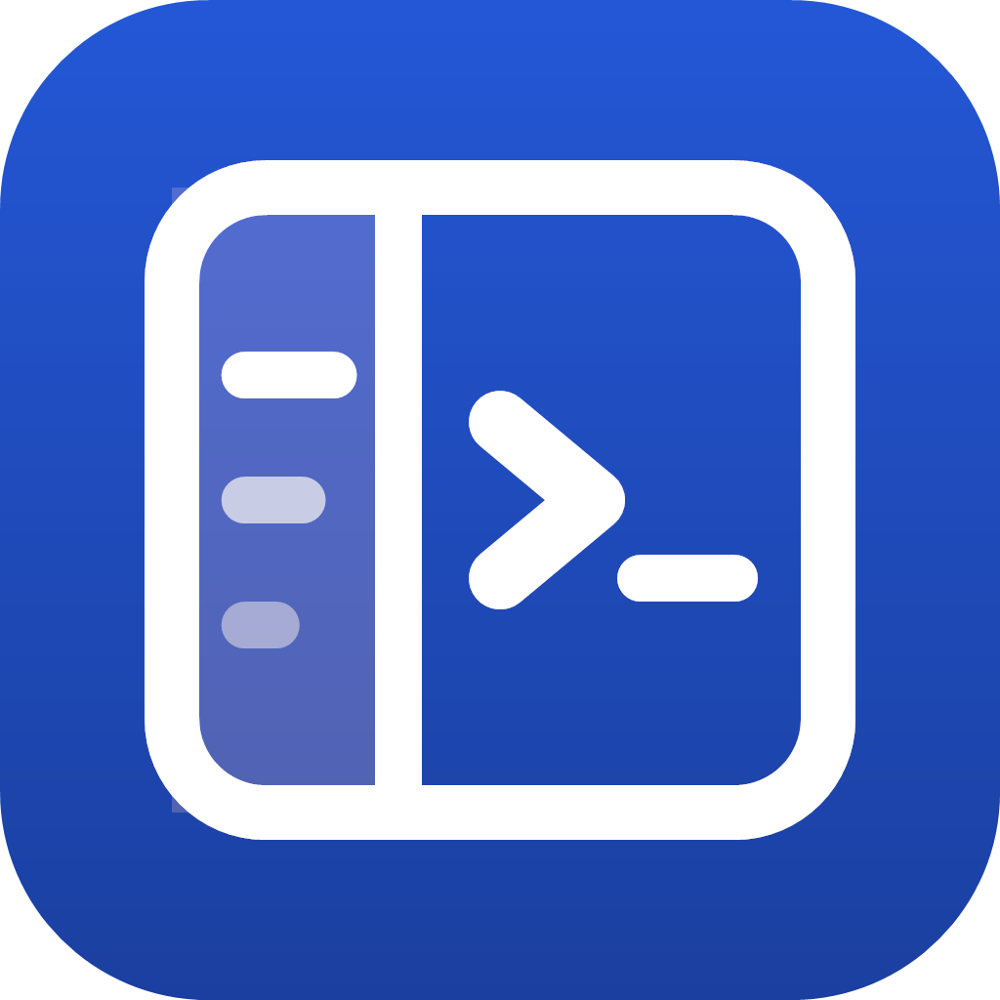
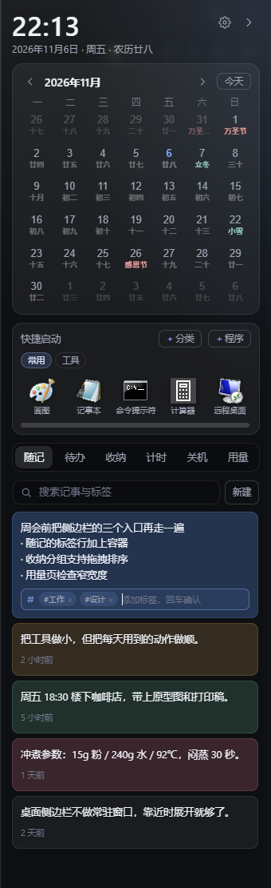
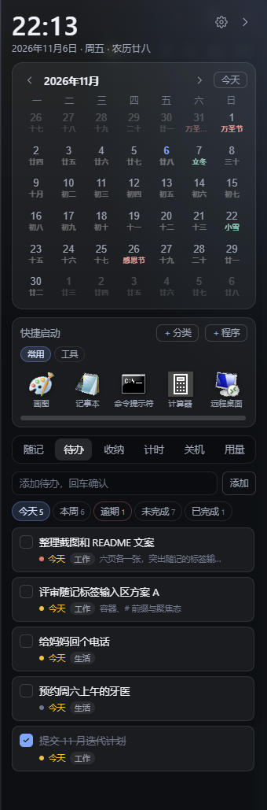
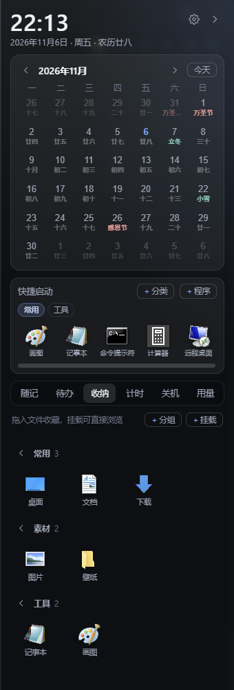
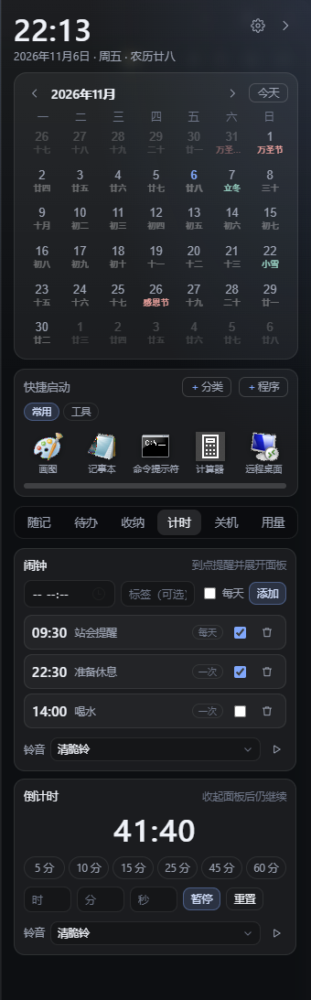
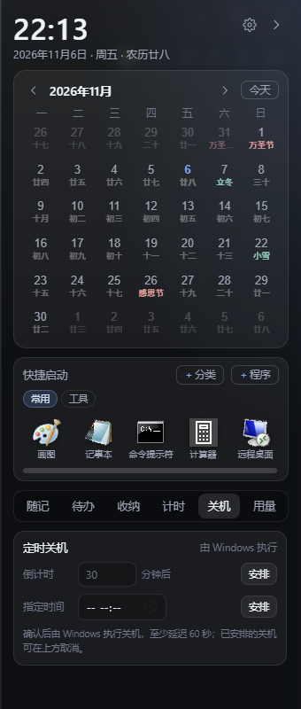
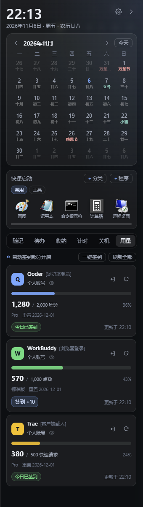

<h1 align="center">
   ZhiAi Assistant
</h1>

<p align="center">A <b>Windows</b> desktop sidebar docked to the screen edge — calendar, todos, notes, shelf, quick launch, timers and usage quotas in one panel</p>

<p align="center">English · <a href="README.en.md">简体中文</a></p>

<p align="center">
  
  
  
  
  
</p>

## Screenshots

<p align="center"><sub>Real screenshots with demo data; click an image to open the full-size version.</sub></p>

<table align="center">
  <tr>
    <td align="center" width="33%">
      <a href="docs/screenshots/notes.png"></a><br>
      <sub>Notes · #tags, search and color markers</sub>
    </td>
    <td align="center" width="33%">
      <a href="docs/screenshots/todos.png"></a><br>
      <sub>Todos · Today / This week / Overdue filters</sub>
    </td>
    <td align="center" width="33%">
      <a href="docs/screenshots/shelf.png"></a><br>
      <sub>Shelf · Grouped favorites and mounted folders</sub>
    </td>
  </tr>
  <tr>
    <td align="center" width="33%">
      <a href="docs/screenshots/timers.png"></a><br>
      <sub>Timers · Alarms and countdowns</sub>
    </td>
    <td align="center" width="33%">
      <a href="docs/screenshots/shutdown.png"></a><br>
      <sub>Shutdown · Minute countdown or scheduled time</sub>
    </td>
    <td align="center" width="33%">
      <a href="docs/screenshots/usage.png"></a><br>
      <sub>Usage · Quotas for three platforms and check-in</sub>
    </td>
  </tr>
</table>

## Features

> **Time & Schedule**

### 1. Calendar

A month grid pinned to the top of the panel, with previous/next month navigation. Each date cell shows the lunar date, solar terms and festivals, marks statutory holidays and adjusted workdays, and holiday data can be refreshed online.

- **Show only what you need**: hide the whole calendar, keep only the Gregorian date, or turn off secondary labels.
- **Straight to todos**: click a date to view or add todos for that day without switching panels.

### 2. Todos

Filter by Today, This Week, Overdue, Unfinished and Completed, each with its own count. Overdue items are highlighted, and the week's plan is clear at a glance.

- **Quick entry**: press Enter to add; while editing, `Enter` saves and `Esc` cancels.
- **Undo a delete**: deletions can be undone within 4 seconds.

### 3. Timers

Alarms and countdowns share one tab, covering both reminders and focus sessions.

- **Alarms**: daily repeat, automatically disabled after a one-shot trigger; 10 built-in ringtones, with mute, preview or your own WAV file.
- **Countdown**: set hours / minutes / seconds, with one-line presets for 5/10/15/25/45/60 minutes, up to 24 hours.

### 4. Shutdown

Schedule a shutdown by minute countdown or at a specific time; a confirmation step is required before submitting.

- Minimum 60 seconds, maximum 7 days; cancel any time before it fires.
- The plan is stored locally and survives closing the sidebar; a "Full reset" also cancels any scheduled shutdown.

> **Notes & Storage**

### 5. Notes

Click New to create a note that is saved immediately and opened for editing; it auto-saves when you pause, without interrupting your flow.

- `#tag` grouping, full-text search, pinning and 9 color markers.
- `Enter` ends editing, `Ctrl+Enter` starts a new paragraph, `Shift+Enter` inserts a line break.

### 6. Shelf

Drag files, folders or shortcuts into the panel to favorite them, keeping frequently used material within reach.

- Custom groups, with drag-and-drop sorting across groups.
- Mount a frequently used folder and browse it level by level on the same page, without opening File Explorer.

### 7. Quick Launch

The app dock below the calendar. Shortcuts dropped into the quick-launch area become launch items directly.

- Categories, a fixed N×N grid, adjustable column/row count, icon size and label visibility.
- Hide the whole block, or switch to horizontal scrolling to fit more apps.

> **Account Usage**

### 8. Usage

Aggregates quotas, reset dates and last-updated times for Qoder, WorkBuddy and Trae — no need to open every client.

- **One-click check-in**: automatic check-in runs once a day, with up to 3 retries on failure.
- **Sign-in**: Qoder / Trae reuse the login state saved by the local client; WorkBuddy authorizes in a browser inside the card.
- A first-visit confirmation is shown on the Usage page; credentials are encrypted at the Windows user level (DPAPI).

## Install & Build

### Use the app

Download `ZhiAi-Assistant.exe` from [Releases](https://github.com/ZhiHui6/ZhiAi-Assistant/releases), put it in any writable directory and double-click it. No installer is needed; the data directory is created on first run.

- Requirements: Windows 10 / 11 x64 and WebView2 Runtime (usually preinstalled on Windows 11 and recent Windows 10).
- Portable mode: Settings → Data → Storage Location can keep data next to the executable; backup export/import also migrates data.
- The binary is not code-signed. When SmartScreen reports "Unknown publisher", choose "More info → Run anyway".

### Build from source

Requires Windows 10 / 11 x64, [Go](https://go.dev/dl/) 1.27+, [Wails CLI v2](https://wails.io/docs/gettingstarted/installation) and the WebView2 Runtime. Node.js is optional and only needed to generate locale entries and lint the frontend.

```powershell
go install github.com/wailsapp/wails/v2/cmd/wails@latest

git clone https://github.com/ZhiHui6/ZhiAi-Assistant.git
cd ZhiAi-Assistant

wails dev                            # hot-reload development, devserver http://localhost:34115
wails build                          # production build, output build\bin\ZhiAi-Assistant.exe
wails build -debug -windowsconsole   # debug build, logs to the current console window
wails build -clean                   # clean build\bin first, then build
```

- **Version**: the in-app version comes from `Version` in `internal/buildinfo/buildinfo.go` (default 1.0.0). Before a release it should match `info.productVersion` in `wails.json`; override it with `wails build -ldflags "-X zhi-ai-assistant/internal/buildinfo.Version=<version>"`. The release tag must equal the version (e.g. `v1.0.0`), otherwise "Check for updates" reports incorrectly.
- **Release**: pushing a `v*` tag (e.g. `v1.0.0`) triggers `.github/workflows/release.yml`, which builds on Windows and uploads `ZhiAi-Assistant.exe` plus a same-named `.sha256` checksum.
- **Updates**: release assets must include `ZhiAi-Assistant.exe` and `ZhiAi-Assistant.exe.sha256` (or a `digest`); otherwise the app can only open the release page for a manual download.
- **Locales**: source entries live in `tools/i18n/`; `frontend/js/locales.js` is generated — run `node tools/i18n/build-locales.js` after changing them.
- **Checks**: `npx eslint --config eslint.config.check.mjs frontend/js` checks frontend syntax and undefined references (run `npm i -D eslint globals` first). The project has no automated tests yet.

## Usage Tips

- **Docking**: the panel docks to the left or right screen edge, expands as the mouse approaches and collapses about 0.2s after it leaves, keeping a bookmark bar when collapsed. The pin holds it open temporarily, disabling auto-hide keeps it always visible, and `Esc` collapses it manually.
- **Tray & hotkeys**: left-click the tray icon to summon the panel; right-click for show/collapse, pin, auto-hide, start with Windows, settings and quit. The global hotkey defaults to `Ctrl+Alt+Space`; if taken, alternative combinations are tried automatically and reported in the tray.
- **Multiple monitors**: choose the dock monitor and left/right edge in settings.
- **Appearance & language**: adjustable glass opacity, surface tint, 12-hour clock, reduced motion and panel/bookmark width; supports Simplified Chinese, English and Traditional Chinese, following the system by default.
- **Caution**: scheduled shutdown really powers off the PC (up to 7 days); "Full reset" deletes all data in the current storage location irreversibly — export a backup first.

## Data & Privacy

Data is stored in `%APPDATA%\ZhiAi-Assistant` by default. Settings → Data → Storage Location can switch to a portable or custom path. Writes are atomic JSON writes with `.bak` backups, per-category export/import is supported, and switching directories copies the data and restarts the app.

The app only goes online to refresh statutory holidays (`timor.tech`), read quotas and run check-ins, and check GitHub for updates; it uploads nothing to any server of its own. Quota reading and check-in reuse the local client's login state or browser authorization; credentials are encrypted with Windows DPAPI, so you must sign in again after changing machines or Windows accounts.

> [!WARNING]
> Quota reading and check-in rely on undocumented platform APIs. This is unofficial, may stop working, and may conflict with platform terms. Use at your own risk, and disable these features if the terms do not allow them.

## Project Layout

```
main.go                  Entry point and Wails setup (sidebar / settings window)
internal/buildinfo/      App name, version and repository URL
internal/core/           Domain modules: calendar/holidays, notes, todos, shelf, mounts, quick launch, timers, usage
internal/i18n/           UI languages
internal/platform/       Win32 window shell, tray, hotkeys, notifications, dialogs, autostart
internal/service/        Frontend bindings, settings, backup and update logic
internal/winstate/       Edge-docked window state machine (expanded / collapsed / pinned)
frontend/                Sidebar and settings window (plain HTML/CSS/JS, no framework)
tools/i18n/              Locale entry lists and the locales.js generator
```

## Tech Stack

- [Go](https://go.dev/): application core, domain logic and service layer
- [Wails v2](https://wails.io/) and WebView2: desktop runtime and window integration
- Win32 API: edge docking, tray, hotkeys, notifications and autostart
- Plain HTML / CSS / JavaScript: sidebar and settings UI, no frontend framework

## License

ZhiAi Assistant is open source under the [GNU General Public License v3.0](LICENSE). Copyright (C) 2026 ZhiHui6.

This program is free software: you can redistribute it and/or modify it under the terms of version 3 of the GNU General Public License as published by the Free Software Foundation. It is distributed in the hope that it will be useful, but WITHOUT ANY WARRANTY.
